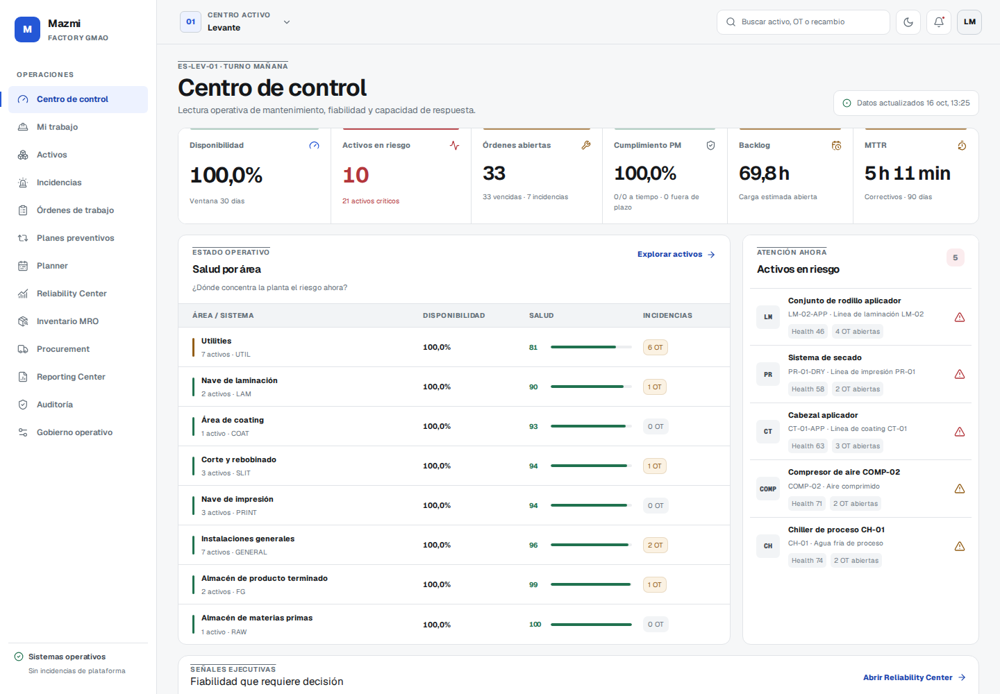
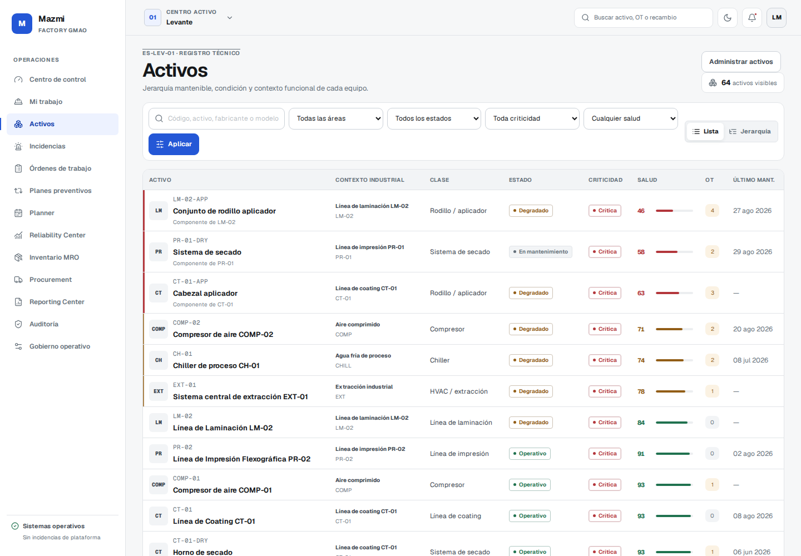
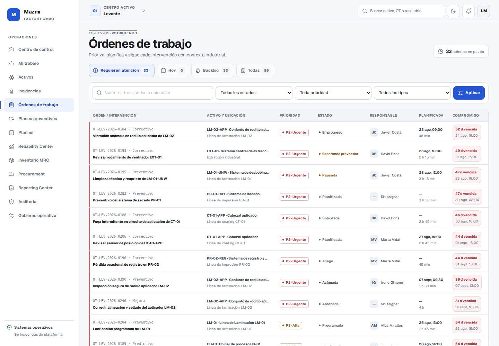
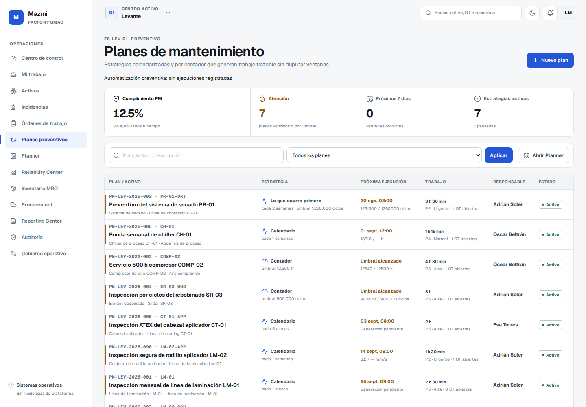
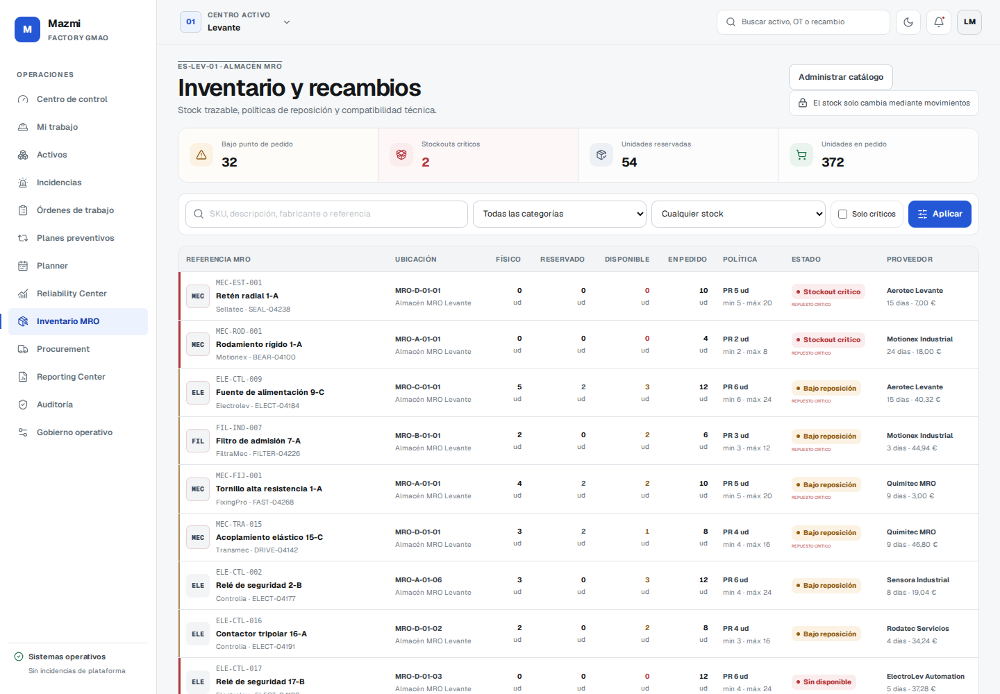
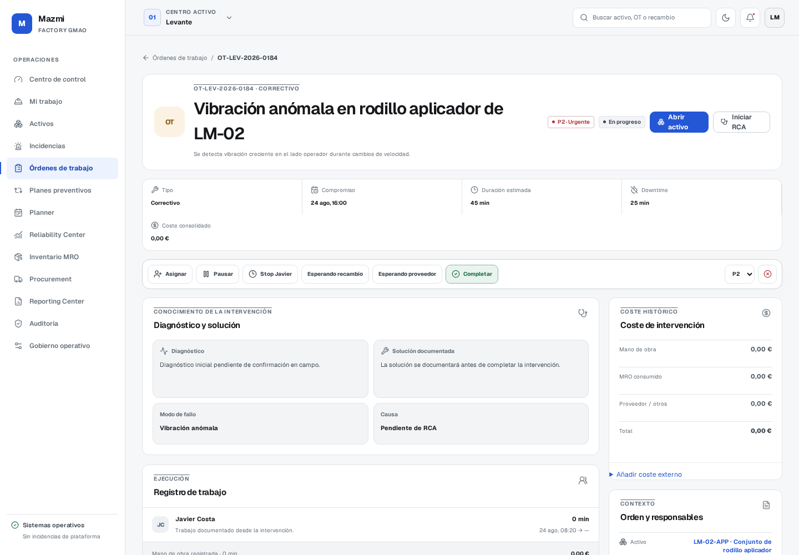
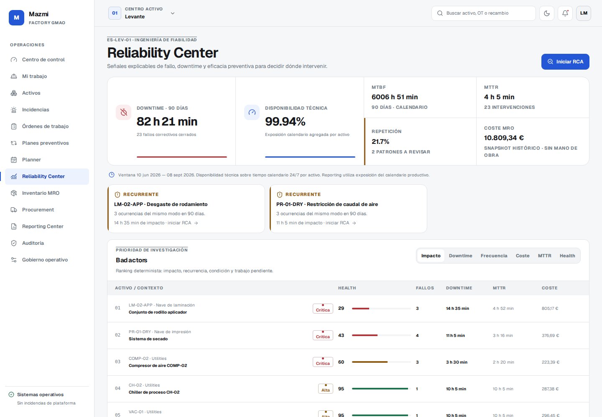
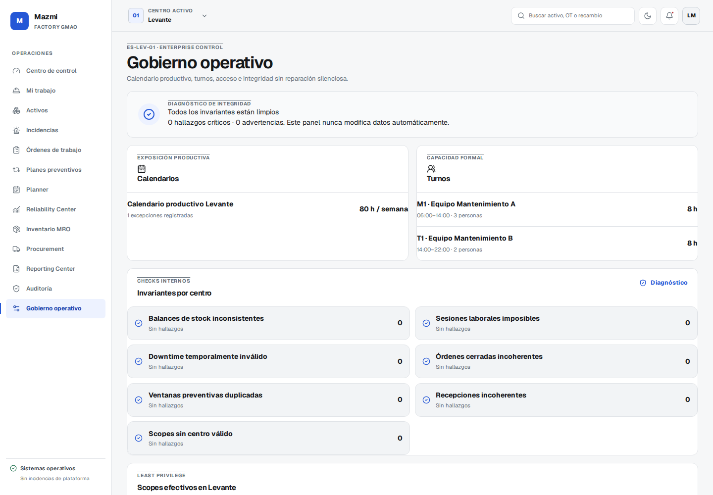

# GMAO / ERP

Industrial Maintenance & Operations Platform

An industrial maintenance platform built around the way a plant actually works: assets in context, traceable interventions, stock movements, preventive planning and explainable reliability signals. The included company and all operational records are fictional demo data.



## Product

- **Operations:** incidents and triage, work-order lifecycle, technician assignments, labor sessions, downtime, checklists, evidence and mobile execution.
- **Assets and planning:** functional-location hierarchy, asset history, calendar/meter-based preventive plans, automatic work-order generation, capacity-aware planner and PM compliance.
- **MRO and supply:** warehouse-scoped stock ledger, reservations and consumption, physical counts, requisitions, purchase orders, partial receipts and transfers.
- **Decision support:** operational overview, deterministic health score, MTBF/MTTR, recurrence, Pareto, RCA, reporting and data-integrity checks.
- **Governance:** server-side role and site/area/warehouse scopes, audit trail, session controls, import center and demo/production modes.

## Screenshots

| Operations                                           | Assets                                                                    |
| ---------------------------------------------------- | ------------------------------------------------------------------------- |
|  |                                  |
|   |  |
|       |                       |
|     |                               |

## Stack and architecture

React 19, TypeScript, Vinext/Vite, Cloudflare Workers, D1 (SQLite), R2, Drizzle ORM, Vitest and Playwright. A modular monolith keeps authorization, domain operations and persistence on the server; the browser never grants itself permissions or updates stock directly. D1 migrations, constraints, idempotency and inventory movements preserve operational history. The optional intelligence layer requires no paid AI API.

See [architecture](docs/architecture.md), [data model](docs/data-model.md), [visual system](docs/visual-system.md), [product domain](docs/product-domain.md) and [pilot-readiness notes](docs/pilot-readiness.md).

## Run locally

Requires Node.js 22.19.x and npm 10.9.x.

```bash
npm ci
npm run dev
```

Open `http://localhost:3000`. Local preview defaults to **DEMO** and initializes its isolated D1 database with fictional seed data. For example, sign in with `responsable@mazmi.demo` / `Mazmi2026!`. Other demo roles are defined in the seed. `docker compose up --build` is also supported.

Configuration is documented in [.env.example](.env.example). Never commit a real `.env` file, Worker secret, local D1 state or R2 contents. **PRODUCTION** mode is deliberately separate: an empty deployment requires owner-only bootstrap via a high-entropy runtime secret, then real master-data import; it does not silently load demo data. See the [operations runbook](docs/operations-recovery.md).

## Quality

```bash
npm run format:check
npm run lint
npm run typecheck
npm test
npm run build
```

The existing CI also exercises the compiled Worker over HTTP and the accumulated operational smoke flow. Headless visual tests are available via `npm run test:visual:compiled` after installing Playwright Chromium.

## Scope and limitations

This is a portfolio demonstration of an industrial product, not a hosted service or a claim about a real factory. Demo credentials and records are intentionally public. Enterprise rollout still requires deployment-specific identity/SSO, operational backup and restore policy, observability, and customer-specific data governance. The local D1/R2 bindings are not production credentials.

## License

**Proprietary — All Rights Reserved.** Source is visible for portfolio, recruitment, demonstration and technical evaluation only. See [LICENSE](LICENSE); no open-source reuse license is granted.
