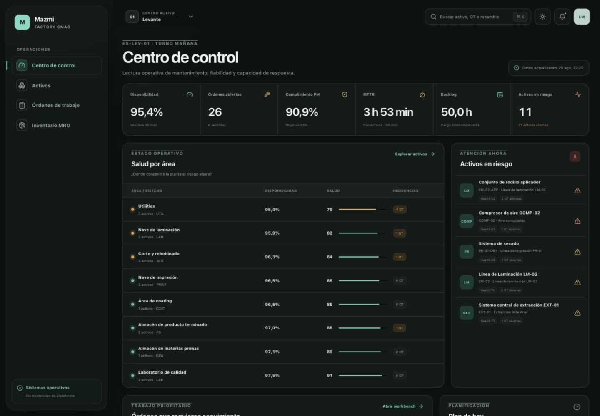

# Mazmi Factory GMAO

V2B de una plataforma Enterprise de Gestión de Mantenimiento, Activos, Preventivo, Planificación, MRO, Fiabilidad, Procurement y ejecución de campo para industria de packaging flexible.

> Complejidad empresarial por debajo. Claridad extrema por encima.



## Qué incluye

- login demo con sesiones opacas, contraseñas derivadas y rutas protegidas;
- permisos data-driven con scopes explícitos de organización, planta, área y almacén;
- shell responsive Industrial Liquid con light/dark, selector de centro, notificaciones y búsqueda global;
- Centro de Control calculado desde downtime, órdenes, preventivo, salud y backlog;
- listado/jerarquía y detalle de activos;
- incidencias, triage y conversión trazable a orden de trabajo;
- workspace de OT con lifecycle, asignación, programación, labor, downtime y cierre;
- inventario MRO integrado con reserva, liberación, consumo, devolución y coste histórico;
- planes preventivos por calendario, contador o primera condición, con checklist, requisitos y materiales previstos;
- generación idempotente de OT preventivas y PM Compliance calculado desde ejecuciones reales;
- Planner semanal con backlog, drag & drop persistido, capacidad y detección de conflictos;
- workforce con turnos, disponibilidad, skills, certificaciones y agenda móvil;
- Reliability Center con MTBF, MTTR, availability, recurrencia, Pareto, tendencias y eficacia preventiva calculados;
- health score determinista y explicable, modos de fallo y ranking de bad actors;
- RCA versionada con evidencias, 5 Whys, acciones correctivas y generación trazable de OT;
- Procurement MRO con requisiciones, ofertas, pedidos, recepciones parciales e idempotentes y transferencias entre ubicaciones;
- señales de reposición y riesgo de repuesto crítico, proveedores aprobados, sustitutos y trazabilidad completa hasta la OT;
- Technician Home y workspace móvil con seguridad, checklist tipado, mediciones, evidencias, QR y relevo;
- sesión endurecida con expiración idle/absoluta, rotación, revocación y bloqueo temporal;
- calendario productivo, tarifas de labor congeladas y coste consolidado de mantenimiento;
- Reporting, Audit y Data Integrity Center con exportaciones y filtros scoped;
- cola offline durable e idempotente limitada a operaciones de campo seguras;
- timeline operativa, expediente técnico del activo y auditoría append-only;
- D1/SQLite real, migración, seed determinista, tests, Docker y CI.

La demo contiene **2 centros, 72 activos, más de 90 órdenes y 180 referencias MRO**. Los datos son ficticios, coherentes y no afirman utilizar maquinaria real de ninguna empresa.

## Inicio rápido

Requisitos: Node.js `22.19+` (rama 22 LTS) y npm 10.

```bash
npm ci
npm run dev
```

Abre [http://localhost:3000](http://localhost:3000). La primera petición aplica la migración y genera el seed industrial en el D1 local de `.wrangler`.

Credenciales demo:

| Perfil                       | Email                    | Contraseña   |
| ---------------------------- | ------------------------ | ------------ |
| Responsable de Mantenimiento | `responsable@mazmi.demo` | `Mazmi2026!` |
| Planner                      | `planner@mazmi.demo`     | `Mazmi2026!` |
| Ingeniero de Fiabilidad      | `fiabilidad@mazmi.demo`  | `Mazmi2026!` |
| Técnico                      | `tecnico1@mazmi.demo`    | `Mazmi2026!` |
| Almacén                      | `almacen@mazmi.demo`     | `Mazmi2026!` |
| Viewer                       | `viewer@mazmi.demo`      | `Mazmi2026!` |

## Docker

```bash
docker compose up --build
```

La aplicación queda disponible en `http://localhost:3000`; el estado D1/Miniflare persiste en el volumen `mazmi_d1_state`. La imagen ejecuta como usuario no-root y expone un healthcheck real.

## Flujo navegable

```text
Login
└─ Centro de Control
   ├─ Activos
   │  └─ Detalle de activo
   ├─ Incidencias
   │  └─ Triage y conversión
   ├─ Órdenes de trabajo
   │  └─ Workspace operativo
   ├─ Planes preventivos
   │  └─ Plan, contador y órdenes generadas
   ├─ Planner
   │  └─ Capacidad, backlog y agenda móvil
   ├─ Inventario MRO
   │  └─ Drawer de referencia y movimientos
   ├─ Reliability Center
   │  └─ Investigación RCA y acciones
   └─ Procurement
      └─ Requisiciones, pedidos, recepciones y transferencias
   ├─ My Work
   │  └─ Ejecución móvil, QR, checklist y evidencias
   ├─ Reporting Center
   ├─ Audit Center
   └─ Gobierno e integridad
```

## Arquitectura

Monolito modular TypeScript sobre Vinext/React, Cloudflare D1 y R2. Las páginas consultan repositorios server-side; el navegador no decide scopes ni contiene datasets industriales hardcodeados. El modelo separa ubicaciones funcionales, activos, planes, contadores, workforce, planificación, órdenes, trabajo, downtime, piezas, almacenes, stock, movimientos, modos de fallo, RCA, gobierno y auditoría.

El stock físico no se edita directamente. `stock_levels` es una proyección optimizada y `inventory_movements` conserva la trazabilidad de recepción, consumo, reserva, liberación, pedido, ajuste, transferencia y devolución.

Consulta:

- [visión y dominio](docs/product-domain.md)
- [arquitectura](docs/architecture.md)
- [modelo de datos](docs/data-model.md)
- [sistema visual](docs/visual-system.md)
- [roadmap](docs/roadmap.md)

## Comandos

| Comando                | Uso                               |
| ---------------------- | --------------------------------- |
| `npm run dev`          | servidor local                    |
| `npm run build`        | build de despliegue               |
| `npm run start`        | servir el bundle con Wrangler     |
| `npm run lint`         | lint                              |
| `npm run typecheck`    | contratos TypeScript              |
| `npm run format:check` | formato                           |
| `npm run test`         | tests unitarios                   |
| `npm run db:generate`  | generar migración Drizzle         |
| `npm run test:e2e`     | smoke HTTP con servidor levantado |
| `npm run check`        | gate completo de calidad          |
| `npm run docker:up`    | levantar con Docker               |

## Seguridad y límites conscientes

- La cookie de sesión es `HttpOnly`, `SameSite=Lax`, opaca y revocable.
- La autorización y el scope se resuelven server-side.
- Las entradas de autenticación y cambio de centro se validan en runtime.
- D1 usa consultas preparadas, constraints e índices por los patrones actuales.
- Las cuentas demo se han creado para este entorno; producción deberá sustituirlas por SSO/IdP corporativo y una política empresarial de sesiones.
- Las acciones V1A–V2B mutan exclusivamente mediante operaciones autorizadas que actualizan proyecciones, ledger, eventos y auditoría de forma coherente.
- No se necesita OpenAI, Anthropic, Gemini ni otra API externa de pago.

## Entornos

`NEXT_PUBLIC_SITE_URL` fija el origen confiable usado por metadata social. Copia `.env.example` únicamente si necesitas cambiar el origen local. Los bindings hospedados permanecen declarados en `.openai/hosting.json`; no hay secretos obligatorios.
